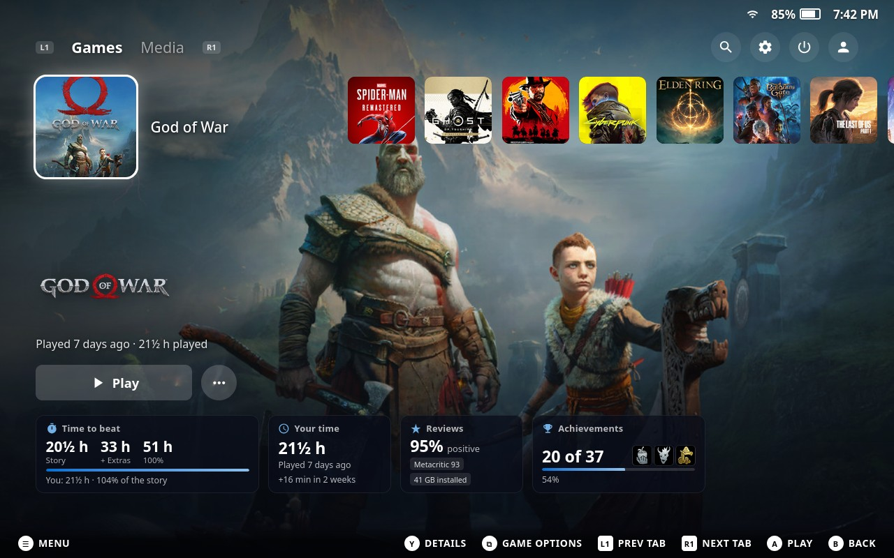
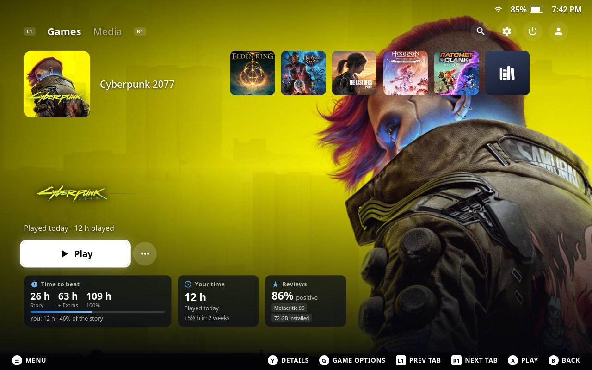
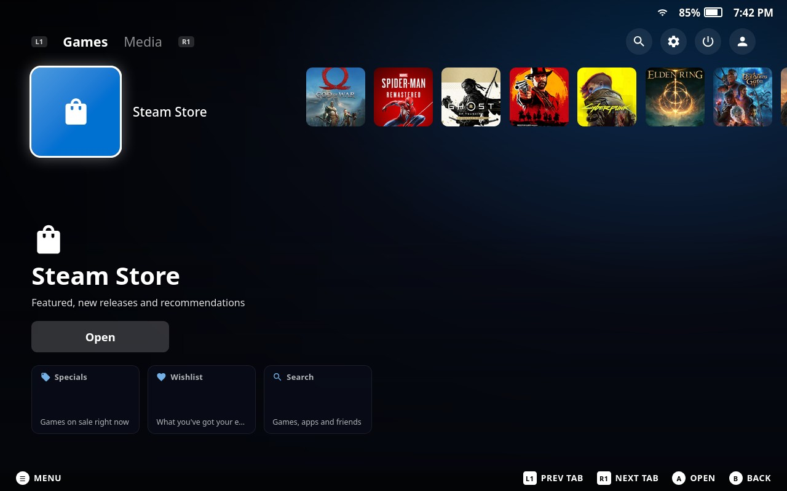
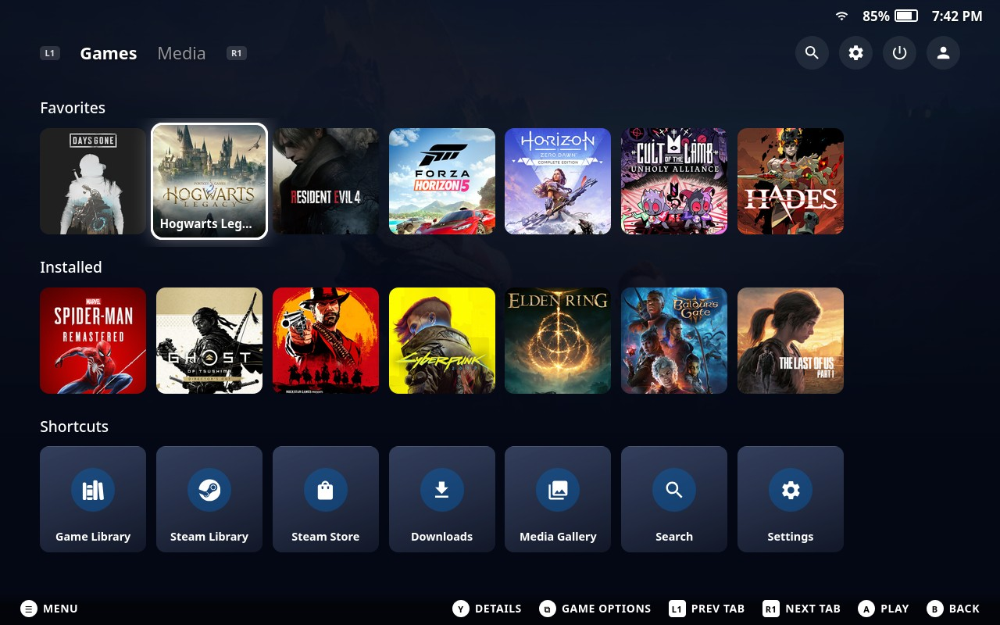
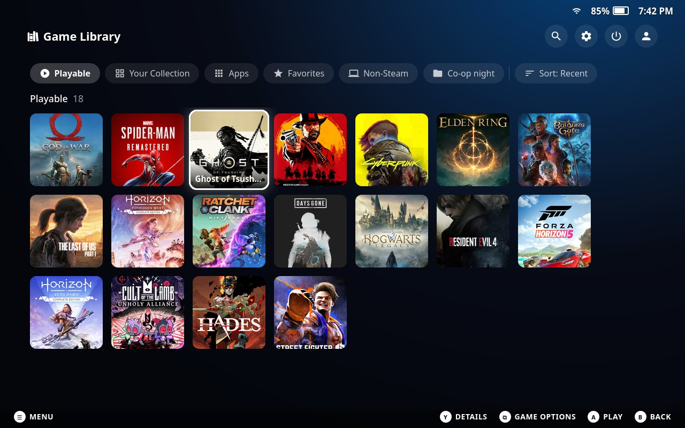
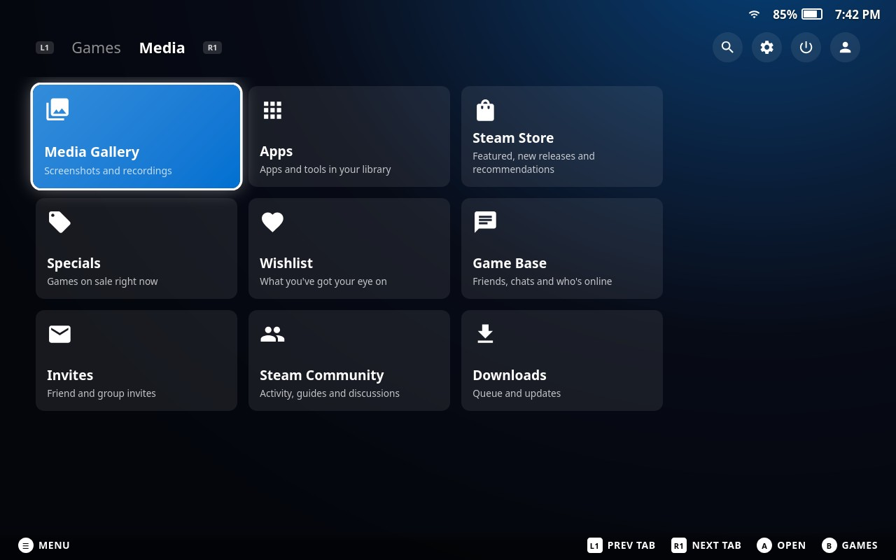
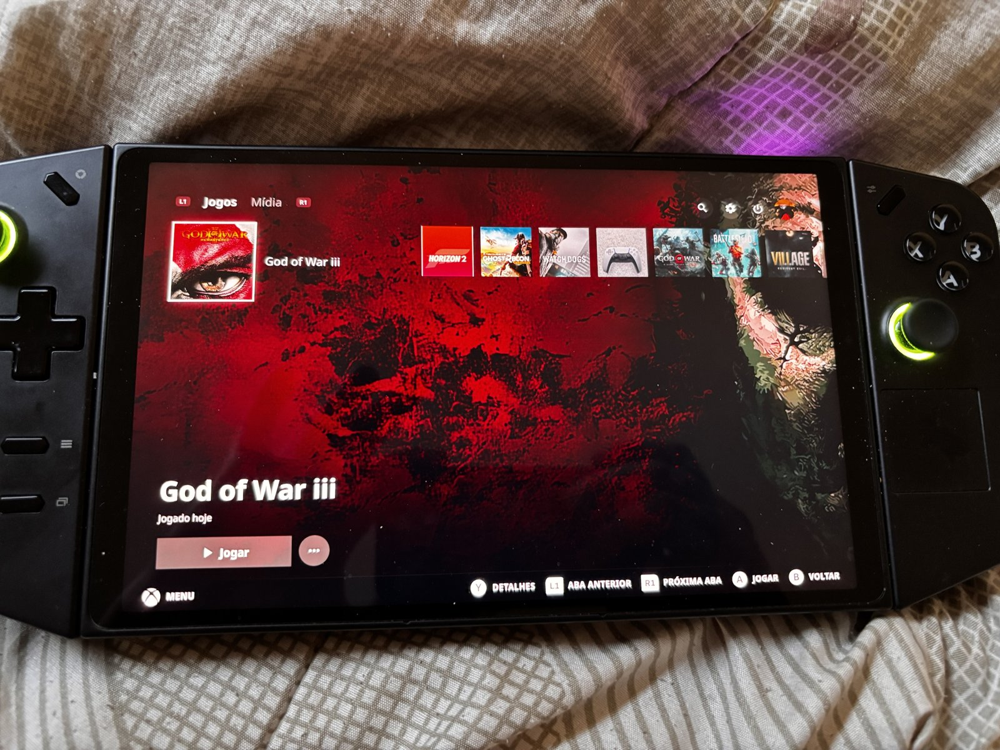
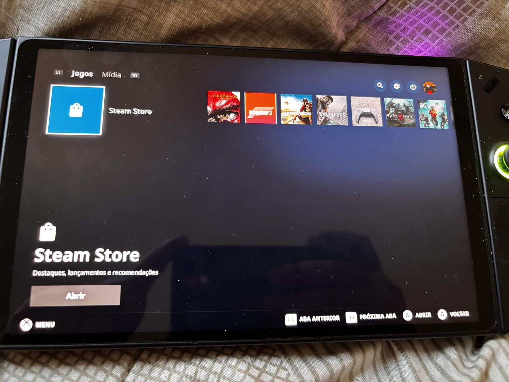

<div align="center">

# PS5 Dashboard

**Make SteamOS Game Mode look and feel like the PlayStation 5 home screen.**

A [Decky Loader](https://decky.xyz) plugin for the Steam Deck and other handhelds running SteamOS.

[](https://github.com/kromossomom-debug/decky-ps5-dashboard/releases/latest)
[](https://github.com/kromossomom-debug/decky-ps5-dashboard/releases)
[](LICENSE)
[](https://decky.xyz)



</div>

## Features

- **PS5 home screen.** Replaces Steam's home with a row of square tiles along the top: the Steam Store first, your
  recent games, and the Game Library at the end. The selected game stays big on the left with its name beside it,
  while its key art fills the whole screen.
- **Game info, PS5 style.** The game's logo, when you last played it and for how long, a white **Play** button and a
  round **⋯** button for the game's options.
- **Info cards under Play:**
  - **Time to beat** from [HowLongToBeat](https://howlongtobeat.com): Story, + Extras and 100%, with a bar showing how
    far into the story your playtime gets you.
  - **Your time:** total playtime, when you last played and the last two weeks.
  - **Reviews:** Steam review score, Metacritic and installed size.
  - **Achievements:** unlocked count, a progress bar and the three most recent unlocks.

  Each card opens the matching page. Under the Store and Game Library tiles the cards become shortcuts (Specials,
  Wishlist, Search, Installed, Games, Apps).
- **Game options on Select.** Press **Select** (View) or **≡** on any game, or pick **⋯**, to open Steam's own game
  menu. It includes what other plugins add to it, such as **SteamGridDB's "Change artwork…"**.
- **Games and Media tabs.** Switch with **L1 / R1**, like on the PS5. Search, Settings, Power and your profile sit in
  the top-right corner.
- **Game Library.** A grid of square tiles with filter pills along the top: Playable, Your Collection, Apps,
  Favorites, Non-Steam and your own collections, sorted by Recent or A–Z.
- **Lower rows.** Scroll down for Favorites, Installed and Shortcuts. The game art dims to PlayStation navy as you go.
- **PS5 colors everywhere.** Repaints Steam's own blues, greens and slate greys with PlayStation blue and the PS5's
  deep, cool greys: menus, buttons, toggles and pages, not just the plugin's screens.
- **Control Center-style menus.** The Steam menu, Quick Access and option menus (such as Power) get a dark rounded
  panel and a white focused item, without Steam's red and green highlights.
- **PS5 effects.** White focus glow, an art crossfade with a slight zoom, a sliding game row and staggered card
  entrances.
- **Accent colors.** PlayStation blue by default, or the console and DualSense colors: Starlight Blue, Cobalt Blue,
  Cosmic Red, Nova Pink, Galactic Purple, Volcanic Red and more.
- **English and Portuguese.** The plugin follows Steam's language.

## Screenshots

| | |
|:-:|:-:|
| <br>**Play** focused, with the info cards | <br>**Steam Store** tile with shortcut cards |
| <br>**Favorites, Installed and Shortcuts** | <br>**Game Library** |
| <br>**Media** tab | |

> These screenshots are rendered from the plugin's own stylesheet at the Steam Deck's 1280×800 resolution, with
> sample library data. The HowLongToBeat times shown are real.

### Running on a handheld

| | |
|:-:|:-:|
|  |  |

*Photos of an earlier build (v1.1) on the author's handheld, with Steam in Portuguese.*

## Installation

### From the release ZIP

1. Install [Decky Loader](https://decky.xyz) if you haven't already.
2. Download **`ps5-dashboard.zip`** from the [latest release](https://github.com/kromossomom-debug/decky-ps5-dashboard/releases/latest).
3. In Game Mode, open **Quick Access (`…`) → Decky → ⚙ Settings → General** and turn on **Developer mode**.
4. Go to **Developer → Install plugin from ZIP** and pick `ps5-dashboard.zip`.
5. Open **Quick Access → Decky → PS5 Dashboard** to adjust it.

To update, install the new ZIP the same way. Your settings are kept.

> Use one dashboard theme at a time. If you also have **Xbox Dashboard** or a CSS Loader theme that restyles the home
> screen, turn it off first, or the two will fight over the home screen and Steam's colors.

## Controls

| Button | Where | Action |
|---|---|---|
| **L1 / R1** | Anywhere | Switch between the Games and Media tabs |
| **A** | Game tile or Play | Play (or resume / view the game if it isn't installed) |
| **Select (View) / ≡** | Any game tile | Steam's game menu: Favorites, Manage, Properties, SteamGridDB's *Change artwork…* |
| **⋯ button** | Game info | Same game menu |
| **Y** | Game tile | Game details page |
| **D-pad down** | Home | Play button → info cards → Favorites, Installed, Shortcuts |
| **B** | Media, Game Library | Back to Games |

## Settings

Everything lives in the plugin panel in Quick Access. Settings are saved to
`~/homebrew/settings/ps5-dashboard/settings.json`.

| Setting | What it does | Default |
|---|---|---|
| Enable PS5 look | Turns the whole theme on or off | On |
| PS5 home screen | Replaces Steam's home with the PS5 one | On |
| Info cards | Cards under the Play button | On |
| HowLongToBeat | Looks up how long each game takes to beat | On |
| PS5 colors everywhere | Repaints Steam's own colors | On |
| Accent color | PlayStation blue or a console / DualSense color | PlayStation blue |
| Home background | Game art, accent gradient or dark | Game art |
| Focus | White glow (PS5) or accent glow | White |
| Tile corner radius | 0–24 px | 12 px |
| Control Center-style menus | Restyles the Steam menu, Quick Access and option menus | On |
| Clean home screen | Hides What's New, Friends and Recommended on Steam's own home | Off |
| PlayStation-style font | Uses SST if installed, otherwise Noto Sans | On |

## Performance

The plugin is built to stay out of the way of your games:

- **GPU-only animation.** Every animation is a transform or an opacity change, so the GPU runs it without the page
  being laid out again. There are no blur filters and no animation that loops forever.
- **No work while you scroll fast.** HowLongToBeat is only looked up after the selection rests on a game for half a
  second, and each answer is cached on disk for a week (misses for a day). Achievements are cached for five minutes.
- **Light DOM.** Rows are memoized, so moving the focus re-renders only the background and the game info. At most
  two background images exist at once.
- **In-place repaint.** Steam's colors are swapped inside its own stylesheets instead of adding a large override
  sheet, and only new stylesheets are scanned afterwards.

## How it works

Steam's CSS class names are hashed and change with every client update, so the plugin never hard-codes them. At
runtime it finds Steam's class modules by their stable key names (`RecentGamesContainer`, `BasicGameCarouselItem`,
`contextMenuItem`…) and builds its stylesheet from them. Steam ships several copies of some modules, like the main
menu and Quick Access, so every copy is matched. The stylesheet goes into each Game Mode window (`SP`, `QuickAccess`,
`MainMenu`) and is put back if Steam recreates one.

The home screen replaces the `/library/home` route through Decky's router patching. If it ever fails to render, Steam's
own home is shown instead. The game menu is Steam's own `LibraryContextMenu`, which is why other plugins' menu items
show up in it.

HowLongToBeat has no public API. The Python backend does what the website does (a short-lived search token, then a
search), matches the Steam name to the closest HowLongToBeat entry and caches the result. Lookups run off the loader's
event loop.

Turning the plugin off or uninstalling it removes everything and restores Steam's original colors.

## Building from source

Requirements: Node.js 18+ and npm.

```bash
git clone https://github.com/kromossomom-debug/decky-ps5-dashboard.git
cd decky-ps5-dashboard
npm install
npm run build
./scripts/package.sh   # creates ps5-dashboard.zip
```

```
src/
  index.tsx      plugin entry, Quick Access panel, route patches
  Shell.tsx      tabs, top-right icons, Media cards
  Ps5Home.tsx    home row, background, game info
  InfoCards.tsx  HowLongToBeat, playtime, reviews and achievement cards
  Library.tsx    Game Library grid
  theme.ts       stylesheet for Steam's own screens
  palette.ts     in-place repaint of Steam's colors
  classes.ts     runtime lookup of Steam's class modules
  styles.ts      stylesheet for the plugin's screens
py_modules/
  hltb_client.py HowLongToBeat lookups with a disk cache
main.py          Decky backend: settings and HowLongToBeat
```

## Known limitations

- A Steam client update can rename the modules the plugin relies on. Parts of the theme then stop applying until the
  plugin is updated. Nothing breaks: the home screen falls back to Steam's own.
- HowLongToBeat matching works by name, so a few games with unusual Steam names may show no times.
- Non-Steam shortcuts have no achievements or reviews, so those cards are hidden for them.

## Support

If you enjoy the plugin, you can [buy the author a coffee](https://buymeacoffee.com/kromossomoc). It helps keep it
updated. Bug reports and ideas are welcome in [Issues](https://github.com/kromossomom-debug/decky-ps5-dashboard/issues).

## Disclaimer

This is an unofficial fan project. It is not affiliated with, endorsed by or sponsored by Sony Interactive
Entertainment, Valve or HowLongToBeat. PlayStation, PS5 and DualSense are trademarks of Sony Interactive
Entertainment Inc. Game artwork shown in the screenshots belongs to its respective owners.

## License

[MIT](LICENSE) © 2026 kromossomo
